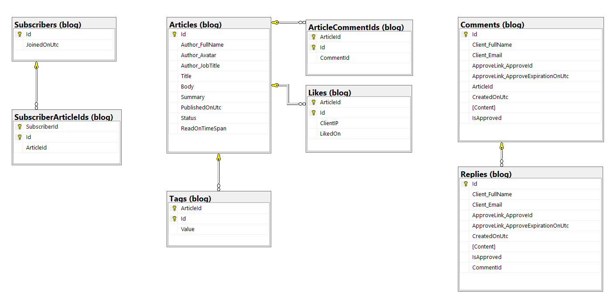

# ASP.NET Core Blog Engine
This document serves as a comprehensive guide for building a modern blog application using Clean Architecture and Domain-Driven Design (DDD) software design approach in ASP.NET Core 10.

> [!TIP]
> Here you can see UI for this api project: `Blogger.UI`

## Give a Star! ⭐
If you find this `Blogger` valuable and believe in the importance of CQRS, Clean Architecture, and Domain-Driven Design, consider showing your support by giving this repository a star!
 
## Getting Started

This repository provides various resources to get you started with building your blog application:

### Index
- [x] [Problem Domain](#problem-domain)
- [x] [Ubiquitous Language](#ubiquitous-language)
- [x] [Domain Objects](#domain-objects)
- [x] [Data Model](#data-model)
- [x] [Aggregates](#aggregates)
- [x] [Repository](#repository)
- [x] [Factory](#factory)
- [x] [Strongly-Typed IDs](#strongly-typed-ids)
- [x] [Domain Events](#domain-events)
- [x] [Clean Architecture](#clean-architecture)
- [x] [Setting Up Our Domain Objects](#setting-up-our-domain-objects)
- [x] [Setting Up Use Cases](#setting-up-use-cases)
- [x] [Persist Data by Using EF Core](#persist-data-by-using-ef-core)
- [x] [Expose Our Features](#expose-our-features)

### Tests

- [x] Unit Tests (44 Passed)
- [x] Integration Tests (40 Passed)
- [x] Functional Tests (20 Passed)

---

### Problem Domain

The core problem addressed by this system is providing a robust, scalable, decoupled blog publishing engine. A modern publishing engine requires:
- Managing articles throughout their lifecycle (draft creation, editing, tagging, publishing, and archiving).
- Engaging reader feedback safely through comments and nested replies, enforced with email-based moderation and confirmation workflows.
- Audience subscription management for newsletters and update broadcasts.
- High separation of concerns between business domain logic, application orchestration (CQRS), persistence mechanisms, and web delivery channels.

---

### Ubiquitous Language

A shared, consistent vocabulary between developers and domain experts is vital in Domain-Driven Design:

| Term | Definition |
| :--- | :--- |
| **Article** | A published or drafted piece of content containing a title, slug, body, summary, read time estimation, tags, and lifecycle status. |
| **Draft** | An unpublished article undergoing composition or revision. |
| **Slug** | A URL-friendly normalized unique identifier derived from an article's title (e.g., `mastering-dotnet-10`). |
| **Comment** | Feedback submitted by a client reader associated with a specific article, requiring moderation before public visibility. |
| **Reply** | A nested response attached to an existing approved comment, requiring individual approval. |
| **Client** | A reader entity encapsulating the full name and email address of a comment or reply author. |
| **Approve Link** | A time-sensitive, unique cryptographic token generated using a snowflake-like identifier used by admins/moderators to verify comments and replies. |
| **Subscriber** | An audience member subscribed to newsletter updates via a verified email address. |
| **Tag** | A categorical label assigned to articles for indexing, filtering, and discovery. |

---

### Domain Objects

The domain layer is completely decoupled from any UI framework or database library. It uses foundational building blocks:
- **Entities**: Objects possessing unique identity that persists across state changes (e.g., `Author`, `Reply`).
- **Value Objects**: Immutable objects distinguished solely by the equality of their attribute values (e.g., `Client`, `Tag`, `ApproveLink`).
- **Aggregate Roots**: Entry-point entities governing a cluster of related objects and enforcing transactional boundary invariants (e.g., `Article`, `Comment`, `Subscriber`).

---

### Data Model

The conceptual and relational database schema reflects aggregates and their relationships:



---

### Aggregates

Aggregates enforce domain invariants at boundaries:
1. **Article Aggregate (`Article`)**:
   - Manages state transitions (`Draft` vs `Published`).
   - Generates read-time calculation automatically based on body word count.
   - Enforces unique slugs and manages article tags.
2. **Comment Aggregate (`Comment`)**:
   - Holds reference to `ArticleId`.
   - Manages nested replies (`Reply`) collection.
   - Guarantees invariant that replies can only be attached to approved comments (`UnapprovedCommentException`).
   - Manages approval tokens (`ApproveLink`).
3. **Subscriber Aggregate (`Subscriber`)**:
   - Encapsulates audience email subscriptions and guarantees email validity.

---

### Repository

Repositories mediate between the domain and data mapping layers:
- `IArticleRepository`: Abstracts article persistence, draft retrieval, slug lookups, archive aggregation, tag queries, and popular article projections.
- `ICommentRepository`: Handles comment creation, lookup by unique approval link, retrieval of approved comments by article, and reply fetching.
- `ISubscriberRepository`: Persists new subscribers and verifies email uniqueness.

Domain aggregates never interact with EF Core directly; repositories defined in `Blogger.Domain` are implemented in `Blogger.Infrastructure`.

---

### Factory

Factory patterns are implemented via static creation methods on aggregate roots to guarantee entities are always initialized in a valid state:
- `Article.CreateArticle(title, body, summary, tags)`: Instantiates a published article with calculated read-time and UTC timestamp.
- `Article.CreateDraft(title, body, summary, tags)`: Instantiates a draft article.
- `Comment.Create(articleId, client, content, approveLink)`: Instantiates a pending comment with a secure approval link.
- `Subscriber.Create(email)`: Validates and creates a subscriber instance.

---

### Strongly-Typed IDs

To avoid primitive obsession and prevent accidentally passing an invalid ID (e.g., passing a `CommentId` where an `ArticleId` is expected), strongly-typed IDs are used throughout:
- `ArticleId`: Encapsulates the unique string slug of an article.
- `CommentId`: Strongly-typed Guid wrapper for comment identifiers.
- `ReplyId`: Strongly-typed Guid wrapper for reply identifiers.
- `SubscriberId`: Strongly-typed Guid wrapper for subscriber identifiers.

EF Core Value Converters map these strongly-typed IDs to and from primitive database columns transparently.

---

### Domain Events

Domain events capture side-effects and inter-aggregate communication:
- `IDomainEvent`: Marker interface for events raised by aggregates.
- `MakeCommentEvent`: Dispatched when a comment is created to trigger notifications (e.g., sending an approval email via `IEmailService`).
- Events are queued on the aggregate root and dispatched during command processing.

---

### Clean Architecture

The solution is structured into four distinct layers according to Clean Architecture principles:

```text
├── src/
│   ├── Blogger.Domain          # Enterprise Business Rules (Aggregates, Value Objects, Domain Events, Repository Interfaces)
│   ├── Blogger.Application     # Application Business Rules (CQRS Handlers, Behaviors, DTOs, Mappings, Validators)
│   ├── Blogger.Infrastructure  # Frameworks & Drivers (EF Core DbContext, Repositories, Migrations, Email, Link Generator)
│   ├── Blogger.APIs            # Interface Adapters (Minimal APIs, Endpoints, Filters, Swagger, Program.cs)
│   └── Blogger.BuildingBlocks  # Shared DDD primitives (Entity, ValueObject, AggregateRoot)
└── tests/
    ├── Blogger.UnitTests       # Pure unit tests for Domain & BuildingBlocks (44 tests)
    ├── Blogger.IntegrationTests# Integration tests using EF Core In-Memory database (40 tests)
    └── Blogger.FunctionalTests # End-to-end API tests via WebApplicationFactory (20 tests)
```

---

### Setting Up Our Domain Objects

Domain entities derive from `Entity<TId>` and aggregate roots derive from `AggregateRoot<TId>`:
- `Id` is protected and assigned through factories.
- Domain rules are encapsulated in instance methods (`Publish()`, `Approve()`, `ReplyComment()`).
- Value objects inherit from `ValueObject` and implement `GetEqualityComponents()`.

---

### Setting Up Use Cases

Use cases are implemented using the **CQRS (Command Query Responsibility Segregation)** pattern with **MediatR**:
- **Commands**: Encapsulate intent to change state (e.g., `CreateArticleCommand`, `MakeDraftCommand`, `PublishDraftCommand`, `MakeCommentCommand`, `SubscribeCommand`).
- **Queries**: Read-only operations optimized for retrieval (e.g., `GetArticlesQuery`, `GetArticleQuery`, `GetArchiveQuery`, `GetPopularArticlesQuery`, `GetTagsQuery`).
- **Validation**: Every request model is validated automatically through `FluentValidation` validator classes before handler execution.
- **Mapping**: Object transformations between requests, commands, domain entities, and responses are handled via `Mapster`.

---

### Persist Data by Using EF Core

Persistence is managed by Entity Framework Core 10:
- `BloggerDbContext`: Configures entities via `IEntityTypeConfiguration<T>`.
- **Value Converters**: Automatically convert strongly-typed IDs (`ArticleId`, `CommentId`, etc.) and value objects (`Tag`, `Client`, `ApproveLink`) to relational columns.
- **Auditing & Tracking**: AsNoTracking used for read-side queries to maximize query performance.
- Relational schema generated and tracked using EF Core Migrations.

---

### Expose Our Features

Features are exposed via ASP.NET Core 10 Minimal APIs using a clean modular pattern:
- Each feature implements `IEndpoint` with a `MapEndpoint(IEndpointRouteBuilder app)` method.
- Endpoints are automatically discovered and registered via reflection with `builder.Services.AddEndpoints()` and `app.MapEndpoints()`.
- Input validation is wired declaratively via `.Validator<TRequest>()` endpoint filters.
- Built-in Swagger/OpenAPI documentation is generated automatically for all endpoints.

---

## Contributing

We welcome contributions to this project! Feel free to open pull requests with improvements, bug fixes, or additional features.
 
## License

This project is licensed under the MIT License: [MIT License](https://opensource.org/licenses/MIT).

## Stay Connected
Feel free to raise any questions or suggestions through GitHub issues.
